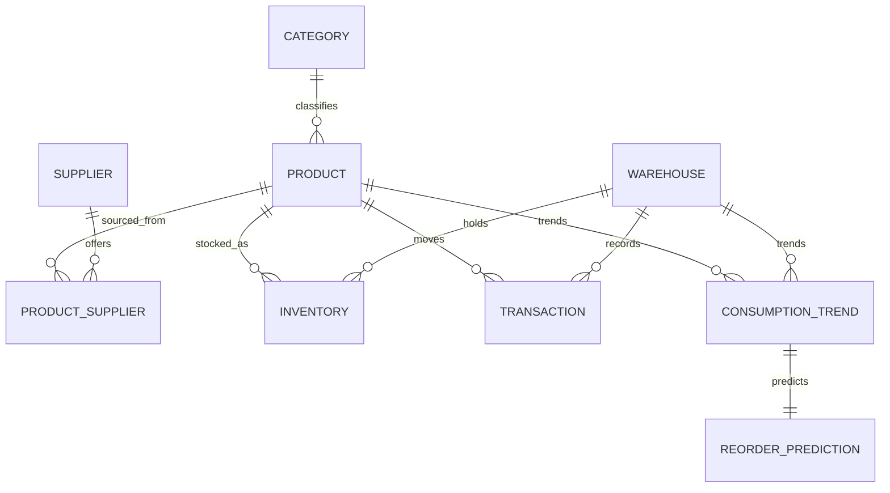

# Entity relationship diagram

The diagram contains the exact nine core relations. PRODUCT_SUPPLIER resolves product/supplier M:N; INVENTORY resolves product/warehouse M:N. TRANSACTION references both product and warehouse with required foreign keys.
